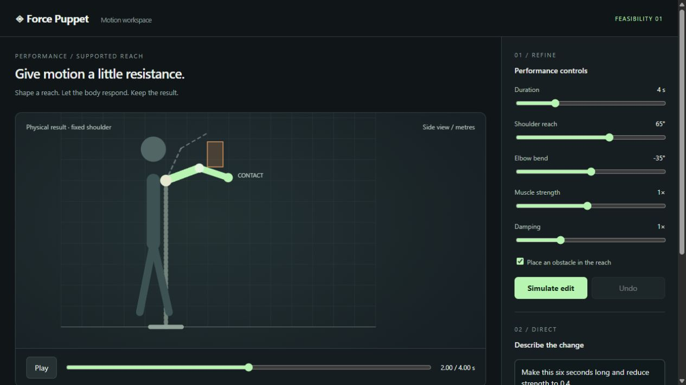

# Homunculus

An experimental animation-authoring workspace: direct a physical character,
refine its performance, and export the motion. **Homunculus** is the first
feasibility experiment within Homunculus.



**Current delivery:** planar and spatial supported-arm synthesis with obstacle contact,
manual timing/strength/pose edits, undo, glTF export and independent replay.
MuJoCo owns the simulation. SAM video observations drive spatial reference motion; the original procedural reach remains available.

**Meta integration:** a real Muse Spark adapter proposes validated edits through
the same controls. Live inference is blocked until API access is configured;
there are no fabricated model responses. SAM 3D Body has processed an owned video on the Linux GPU worker. Temporal cleanup, spatial retargeting, bounded controller search and physical glTF baking are implemented; see [synthesis](docs/SYNTHESIS.md) and [video capture instructions](docs/CAPTURE.md).
This is not yet the complete
Meta-powered product, a full-body controller, or a game-ready retargeted clip.

See [current capabilities and contracts](docs/STATUS.md) for spatial limits,
asset replay and quality-evaluation boundaries.

## Run

```powershell
python -m venv .venv
.venv/Scripts/python.exe -m pip install -r requirements.txt
.venv/Scripts/python.exe server.py
```

Open **http://127.0.0.1:8765**. On Linux, substitute `.venv/bin/python`.

The viewport is a WebGL 3D scene: drag to orbit, scroll to zoom, right-drag to
pan, double-click to reset. three.js is vendored as `web/vendor/three.js`, so the
editor runs offline; after changing `web/vendor/three-entry.js`, rebuild it with
`npm ci && npm run build:three`.

### Your game character

Point the server at a GLB character and the editor poses it with the result, and
**Export character GLB** writes that character with a `Homunculus_Reach` clip
on its own skeleton (its other clips are left out). The file stays where it is;
it is never copied into this repository. Put this in the ignored `.env.local`:

```
HOMUNCULUS_CHARACTER=C:\path\to\bevy-playground\assets\characters\stickman\stickman.glb
```

or pass `--character <path>` to `server.py`. The rig needs the Bevy-playground
stickman contract: one skin, +Y up, facing +Z, bones along local +Y and
`shoulder/upper_arm/forearm/hand.L|R`. The recording view decides the axes:
**facing camera** (default for 3D captures) keeps camera right/up/toward as the
character's left/up/forward; **side-on** (planar captures and the demo) makes the
reach direction the character's forward. Override it with **Recording view**. Only arm directions transfer;
the character keeps its own (shorter) proportions and rest body pose, so its hand
can stop short of where the physics hand touched. Tick **Show physics arm** to
compare. See `character.py` for the exact conventions.

**Full skeleton.** Captures that carry SAM's 70 body keypoints drive all 19
moving bones (pelvis, spine, chest, neck, head, clavicles, arms, hands, legs and
feet) and the pelvis height, exported as a `Homunculus_Body` clip. The captured
arm still comes from the physics result; the rest is kinematic and stays in
place (no travel, no foot IK). The rig also needs `root` at the origin and
`pelvis, spine, chest, neck, head, thigh/shin/foot/toe.L|R`. New worker runs
record the keypoints; for an older run with its `raw-*.npz` files:

```
python add_body.py private/run-001 private/run-001/capture-body.json
```

Import `capture-body.json` as usual. See `body.py` for the per-bone rules.

```powershell
.venv/Scripts/python.exe -m pytest -q
.venv/Scripts/python.exe measure.py
```

Measurements and original-motion exports are written to ignored `outputs/`.
Published baseline evidence is in [docs/evidence](docs/evidence/).

## What to try

1. Watch the green arm meet the obstacle while the dotted target continues.
2. Remove the obstacle and simulate again to compare the free reach.
3. Increase duration or reduce strength, simulate, then undo.
4. Export glTF and switch to export replay. This replays the actual physics result.
5. After configuring Meta access, ask Spark for a bounded edit, review it and apply.

The shoulder is fixed to the world; the surrounding body silhouette is scenery.
No free-standing balance or human muscle-force reconstruction is claimed.

- [Setup and next experiment](docs/SETUP.md)
- [Video to physical arm](docs/CAPTURE.md)
- [Selected architecture and hardware inventory](docs/DECISIONS.md)
- [Policies for every candidate model](docs/MODEL_POLICIES.md)
- [Measured results and limitations](docs/EXPERIMENTS.md)

Source code uses this repository's existing MIT license. MuJoCo, model weights,
datasets and any future third-party rigs retain their own terms. No private game
assets, source recordings, credentials or model weights are included.

### Muse workspace tools

Use **Direct the workspace** to chat, attach image/video/capture/scene files,
and run validated app actions. The **Command inspector** exposes the exact
same tools for manual testing. Scene props are visual only; offline SAM jobs
remain separate. [Architecture, review and limitations](docs/MUSE_WORKSPACE.md).
